<h2><code>$ whoami</code></h2>

Ayush (@0xReso). Data and agent engineer in New Delhi: I build data pipelines and agentic analytics tools. B.Tech CSE, DTU '26. Writing at <a href="https://medium.com/@0xReso">medium.com/@0xReso</a> and <a href="https://0xreso.github.io/upskiller-notes/">0xreso.github.io/upskiller-notes</a>.

<picture>
  <source media="(max-width: 600px) and (prefers-reduced-motion: reduce) and (prefers-color-scheme: dark)" srcset="./assets/whoami-mobile-dark-static.svg">
  <source media="(max-width: 600px) and (prefers-reduced-motion: reduce)" srcset="./assets/whoami-mobile-light-static.svg">
  <source media="(prefers-reduced-motion: reduce) and (prefers-color-scheme: dark)" srcset="./assets/whoami-dark-static.svg">
  <source media="(prefers-reduced-motion: reduce)" srcset="./assets/whoami-light-static.svg">
  <source media="(max-width: 600px) and (prefers-color-scheme: dark)" srcset="./assets/whoami-mobile-dark.svg">
  <source media="(max-width: 600px)" srcset="./assets/whoami-mobile-light.svg">
  <source media="(prefers-color-scheme: dark)" srcset="./assets/whoami-dark.svg">
  
</picture>

<picture>
  <source media="(prefers-reduced-motion: reduce) and (prefers-color-scheme: dark)" srcset="./assets/typing-dark.svg">
  <source media="(prefers-reduced-motion: reduce)" srcset="./assets/typing-light.svg">
  <source media="(prefers-color-scheme: dark)" srcset="https://readme-typing-svg.demolab.com?font=JetBrains+Mono&weight=500&size=22&duration=2200&pause=1800&color=FFFFFF&background=00000000&center=false&vCenter=true&width=720&height=40&lines=Data+and+agent+engineer">
  
</picture>

<!-- readme-atelier:start -->
<!-- Generated by Readme Atelier (https://github.com/monokernn/readme-atelier). Edit atelier.yml instead of this block. -->

<picture><source media="(prefers-color-scheme: dark)" srcset="./atelier/header-dark.1955eaa1.svg"/></picture>

  <picture><source media="(prefers-color-scheme: dark)" srcset="./atelier/stats-dark.8dd22550.svg"/></picture>
  <picture><source media="(prefers-color-scheme: dark)" srcset="./atelier/languages-dark.fe73bd86.svg"/></picture>

<picture><source media="(prefers-color-scheme: dark)" srcset="./atelier/activity-dark.233f5b9f.svg"/></picture>

<!-- readme-atelier:end -->

<h2><code>$ ls ~/projects</code> (04)</h2>

<strong>(Java)</strong> <a href="https://github.com/0xReso/WorkQueue">WorkQueue</a> 
A Redis-backed distributed job orchestrator with a Lua token-bucket rate limiter and DAG workflows.

<strong>(Python)</strong> <a href="https://github.com/0xReso/deepfake-face-swap-autoencoder">deepfake-face-swap-autoencoder</a> 
A face-swap autoencoder with VGG16 perceptual loss and dlib landmark blending.

<strong>(TypeScript)</strong> <a href="https://github.com/0xReso/PortfolioTemplate">PortfolioTemplate</a> 
A modern portfolio template with a premium dark theme and animations.

<strong>(TypeScript)</strong> <a href="https://github.com/0xReso/BusKaro">BusKaro</a> 
A full-stack app built with Spring Boot and React (Vite).

<strong>(Jupyter)</strong> <a href="https://github.com/0xReso/ICG">ICG</a> 
A deep-learning image caption generator.

<strong>(TypeScript)</strong> <a href="https://github.com/0xReso/CPZENworking">CPZENworking</a> 
A competitive programming learning platform with a React (Vite) frontend and a Node.js Express backend.

<h2><code>$ cat wins.log</code> (05)</h2>

An agentic analytics bot: 14 typed tools answering questions across 2,400+ outlets.

A feedback ingestion pipeline: 8.3M+ customer records, refreshed weekly.

Experiment pipelines that match outlets automatically so tests run smoothly.

<picture>
  <source media="(max-width: 600px) and (prefers-reduced-motion: reduce) and (prefers-color-scheme: dark)" srcset="./assets/wins-mobile-dark-static.svg">
  <source media="(max-width: 600px) and (prefers-reduced-motion: reduce)" srcset="./assets/wins-mobile-light-static.svg">
  <source media="(max-width: 600px) and (prefers-color-scheme: dark)" srcset="./assets/wins-mobile-dark.svg">
  <source media="(max-width: 600px)" srcset="./assets/wins-mobile-light.svg">
  <source media="(prefers-reduced-motion: reduce) and (prefers-color-scheme: dark)" srcset="./assets/wins-dark-static.svg">
  <source media="(prefers-reduced-motion: reduce)" srcset="./assets/wins-light-static.svg">
  <source media="(prefers-color-scheme: dark)" srcset="./assets/wins-dark.svg">
  
</picture>

more at <a href="https://0xreso.dev">0xreso.dev</a>

<h2><code>$ cat ~/.stack</code> (06)</h2>

<strong>+ (01)&nbsp;&nbsp;Languages and data</strong> 
Python · SQL · DuckDB · pandas · scikit-learn · Amazon Redshift

<strong>+ (02)&nbsp;&nbsp;AI / agent engineering</strong> 
AWS Bedrock (Claude Sonnet) · AWS boto3 · Gemini API (batched requests) · LightFM · Claude · MCP · agent skills · agent config files (CLAUDE.md / AGENTS.md / Cursor rules)

<strong>+ (03)&nbsp;&nbsp;Apps and ops</strong> 
Streamlit · Linux (cron) · Jupyter

<strong>+ (04)&nbsp;&nbsp;Projects</strong> 
Java · Spring Boot · Redis · Maven · TensorFlow · Keras · OpenCV · dlib

<h2><code>$ cat education.txt</code> (07)</h2>

B.Tech CSE, Delhi Technological University (2022–2026), CGPA 8.36/10.

<h2><code>$ write ~/inbox</code> (08)</h2>

  <a href="https://0xreso.dev">0xreso.dev</a>
  ·
  <a href="https://x.com/0xReso">@0xReso</a>
  ·
  <a href="https://github.com/0xReso">github.com/0xReso</a>
  ·
  <a href="https://medium.com/@0xReso">medium.com/@0xReso</a>
  ·
  <a href="https://0xreso.github.io/upskiller-notes/">upskiller-notes</a>

