<h2><code>$ whoami</code></h2>

<picture>
  <source media="(max-width: 600px) and (prefers-reduced-motion: reduce) and (prefers-color-scheme: dark)" srcset="./assets/whoami-mobile-dark-static.svg">
  <source media="(max-width: 600px) and (prefers-reduced-motion: reduce)" srcset="./assets/whoami-mobile-light-static.svg">
  <source media="(prefers-reduced-motion: reduce) and (prefers-color-scheme: dark)" srcset="./assets/whoami-dark-static.svg">
  <source media="(prefers-reduced-motion: reduce)" srcset="./assets/whoami-light-static.svg">
  <source media="(max-width: 600px) and (prefers-color-scheme: dark)" srcset="./assets/whoami-mobile-dark.svg">
  <source media="(max-width: 600px)" srcset="./assets/whoami-mobile-light.svg">
  <source media="(prefers-color-scheme: dark)" srcset="./assets/whoami-dark.svg">
  
</picture>

<picture>
  <source media="(prefers-reduced-motion: reduce) and (prefers-color-scheme: dark)" srcset="./assets/typing-dark.svg">
  <source media="(prefers-reduced-motion: reduce)" srcset="./assets/typing-light.svg">
  <source media="(prefers-color-scheme: dark)" srcset="https://readme-typing-svg.demolab.com?font=JetBrains+Mono&weight=500&size=22&duration=2200&pause=1800&color=ECECEA&background=00000000&center=false&vCenter=true&width=720&height=40&lines=Associate+Data+Scientist">
  
</picture>

<!-- readme-atelier:start -->
<!-- Generated by Readme Atelier (https://github.com/monokernn/readme-atelier). Edit atelier.yml instead of this block. -->

<picture><source media="(prefers-color-scheme: dark)" srcset="./atelier/header-dark.698f2598.svg"/></picture>

  <picture><source media="(prefers-color-scheme: dark)" srcset="./atelier/stats-dark.043782e0.svg"/></picture>
  <picture><source media="(prefers-color-scheme: dark)" srcset="./atelier/languages-dark.cdb4236d.svg"/></picture>

<picture><source media="(prefers-color-scheme: dark)" srcset="./atelier/activity-dark.f1bd9156.svg"/></picture>

<!-- readme-atelier:end -->

<h2><code>$ ls ~/projects</code> (04)</h2>

<strong>(Case study)</strong> <a href="https://0xreso.dev">Store.AI / IRA</a> 
Intelligent Restaurant Analytics: analyses 78 lakh CSAT, 3.82 lakh ORS and 1.42 lakh Google reviews, classified with Gemini into DuckDB and shown in a Streamlit dashboard with geo drill-down.

<strong>(Case study)</strong> <a href="https://0xreso.dev">Agentic analytics bot</a> 
AWS Bedrock (Claude Sonnet) bot with 14 typed DuckDB tools for plain-English questions across 2,400+ stores; uses up to 5 tool-use rounds, routing guards and parameterised SQL so answers stay grounded.

<strong>(Case study)</strong> <a href="https://0xreso.dev">Personalised menu sequencing</a> 
A LightFM recommender in production with recency boosting and scheduled reruns.

<strong>(Case study)</strong> <a href="https://0xreso.dev">Cashback experiment (intern)</a> 
Control–treatment cohorts on Redshift; tiered wallet cashback with an estimated impact of ₹3.5 Cr+.

<strong>(Case study)</strong> <a href="https://0xreso.dev">Store clustering (intern)</a> 
K-Means on 6-month sales and footfall, split by pricing tier, with 1–2% intra-cluster variance.

<h2><code>$ ls ~/src</code> (05)</h2>

<strong>(Repository)</strong> <a href="https://0xreso.dev">WorkQueue</a> 
A Redis-backed distributed job orchestrator with a Lua token-bucket rate limiter and DAG workflows.

<strong>(Repository)</strong> <a href="https://0xreso.dev">Deepfake Face-Swap Autoencoder</a> 
Shared encoder with dual decoders, VGG16 perceptual loss and dlib landmark blending, evaluated with SSIM, PSNR and MSE.

<strong>(Portfolio)</strong> <a href="https://0xreso.dev">0xreso.dev</a> 
The public site for this work.

<h2><code>$ cat wins.log</code> (06)</h2>

<picture>
  <source media="(max-width: 600px) and (prefers-reduced-motion: reduce) and (prefers-color-scheme: dark)" srcset="./assets/wins-mobile-dark-static.svg">
  <source media="(max-width: 600px) and (prefers-reduced-motion: reduce)" srcset="./assets/wins-mobile-light-static.svg">
  <source media="(max-width: 600px) and (prefers-color-scheme: dark)" srcset="./assets/wins-mobile-dark.svg">
  <source media="(max-width: 600px)" srcset="./assets/wins-mobile-light.svg">
  <source media="(prefers-reduced-motion: reduce) and (prefers-color-scheme: dark)" srcset="./assets/wins-dark-static.svg">
  <source media="(prefers-reduced-motion: reduce)" srcset="./assets/wins-light-static.svg">
  <source media="(prefers-color-scheme: dark)" srcset="./assets/wins-dark.svg">
  
</picture>

<h2><code>$ cat ~/.stack</code> (07)</h2>

<strong>+ (01)&nbsp;&nbsp;Languages and data</strong> 
Python · SQL · DuckDB · pandas · scikit-learn · Amazon Redshift

<strong>+ (02)&nbsp;&nbsp;AI</strong> 
AWS Bedrock (Claude Sonnet) · Gen AI (Gemini) · LightFM

<strong>+ (03)&nbsp;&nbsp;Apps and ops</strong> 
Streamlit · Linux (cron) · Jupyter

<strong>+ (04)&nbsp;&nbsp;Projects</strong> 
Java · Spring Boot · Redis · Maven · TensorFlow · Keras · OpenCV · dlib

<h2><code>$ cat education.txt</code> (08)</h2>

B.Tech CSE, Delhi Technological University (2022–2026), CGPA 8.36/10.

<h2><code>$ write ~/inbox</code> (09)</h2>

  <a href="https://0xreso.dev">0xreso.dev</a>
  ·
  <a href="https://x.com/0xReso">@0xReso</a>
  ·
  <a href="https://github.com/0xReso">github.com/0xReso</a>

